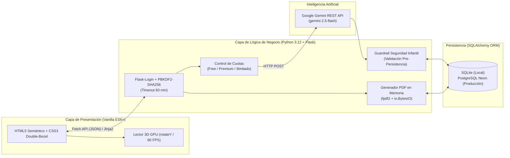
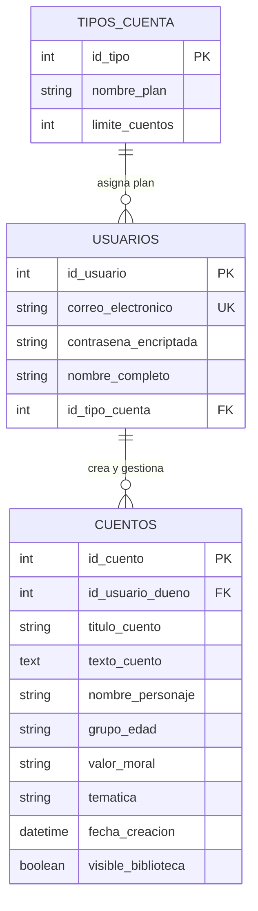

# Dulces Sueños AI

**Plataforma web interactiva para la generación, personalización y lectura inmersiva de cuentos infantiles nocturnos impulsada por Inteligencia Artificial.**

     

---

## Descripción General

**Dulces Sueños AI** acompaña el momento previo al descanso infantil (niños y niñas de **4 a 10 años**) mediante relatos pedagógicos creados a medida en tiempo real. A diferencia de los generadores de texto genéricos o de los catálogos editoriales cerrados, la plataforma combina un motor de generación basado en **Google Gemini (`gemini-2.5-flash`)** con un **protocolo estricto de seguridad infantil** en el servidor y un **visor de lectura 3D artesanal** que simula la apertura y el paso de páginas de un libro ilustrado.

Todo el front-end se ha construido sin frameworks ni dependencias externas (HTML5 semántico, CSS3 puro con arquitectura *Double-Bezel* y JavaScript Vanilla ES6+) para garantizar tiempos de carga inmediatos, animaciones fluidas a **60 FPS** aceleradas por GPU y cumplimiento de los estándares de accesibilidad **WCAG AA**.

---

## Características Principales

| Área | Funcionalidad | Detalle Técnico |
| :--- | :--- | :--- |
| **Generación con IA** | Cuentos personalizados en segundos | Integración HTTP POST asíncrona con `gemini-2.5-flash` ajustando protagonista, temática, rango de edad y valor moral. |
| **Seguridad Infantil** | Filtro *Guardrail* pre-persistencia | Intercepción en backend (`HTTP 400`) ante temáticas violentas, terroríficas o no aptas antes de almacenar datos. |
| **Lector Libro 3D** | Lectura inmersiva a doble página | Paginación dinámica por altura real en 2 columnas sobre `libro_abierto.png`, letra capital y transiciones `rotateY()` por GPU. |
| **Biblioteca Personal** | Estantería con PDF y borrado lógico | Cuadrícula de portadas (`libro_cerrado.png`), descarga directa en PDF (`fpdf2`) y ocultado lógico (`visible_biblioteca = False`). |
| **Suscripciones** | Control de cuotas mensuales | Gestión de planes **Free** (5 cuentos/mes), **Premium** (20/mes) e **Ilimitado** (-1) validados en servidor (`HTTP 403`). |
| **Autenticación** | Seguridad de cuentas y sesiones | Derivación criptográfica `PBKDF2:SHA-256` y cierre automático tras **60 minutos** de inactividad (`@app.before_request`). |

---

## Arquitectura del Sistema

La aplicación sigue un patrón cliente-servidor multicapa desacoplado que permite ejecutar el entorno local sobre **SQLite** y escalar en producción hacia **Render** (WSGI con Gunicorn) y **Neon** (PostgreSQL Serverless) sin modificar el código de negocio:



---

## Modelo de Datos Relacional

El esquema relacional está gestionado mediante **SQLAlchemy ORM** y compuesto por tres entidades principales con integridad referencial:



> **Nota sobre integridad de cuotas:** Al retirar un cuento de la estantería mediante `/borrar-cuento/<id>`, el sistema aplica un **borrado lógico** (`visible_biblioteca = False`). El libro deja de mostrarse en la interfaz del usuario, pero el registro permanece en base de datos para mantener el cómputo exacto de la cuota mensual del plan contratado.

---

## Protocolo de Seguridad Infantil

Dado que el público objetivo son niños de entre 4 y 10 años, cada solicitud enviada a Gemini encapsula las variables del usuario dentro de un *System Prompt* cerrado que aplica tres barreras:

1. **Directiva de Rechazo Semántico:** Si el modelo detecta violencia, terror, monstruos agresivos, política o contenido adulto, aborta la redacción y devuelve exclusivamente la respuesta de bloqueo configurada.
2. **Intercepción en Backend:** Antes de ejecutar `db.session.commit()`, `app.py` inspecciona la respuesta. Si detecta el mensaje de bloqueo, descarta el contenido y devuelve `HTTP 400 Bad Request` con una sugerencia amable.
3. **Salida Limpia y Estructurada:** Se prohíbe el uso de sintaxis Markdown (`#`, `**`) y se exige una extensión sosegada de entre **8 y 10 párrafos** orientada a conciliar el sueño.

---

## Estructura del Proyecto

```text
Dulces_Suenos_IA/
├── app.py                     # Servidor Flask, modelos ORM, endpoints REST, PDF y seguridad
├── requirements.txt           # Dependencias Python (Flask, Flask-Login, SQLAlchemy, requests, fpdf2)
├── .env                       # Variables de entorno (SECRET_KEY, GEMINI_API_KEY, DATABASE_URL)
├── templates/
│   └── index.html             # Plantilla principal Jinja2, modales accesibles y visor 3D
├── static/
│   ├── css/
│   │   └── styles.css         # Paleta nocturna WCAG AA, arquitectura Double-Bezel y responsive
│   ├── js/
│   │   └── main.js            # Lógica AJAX, paginación dinámica por altura real y animación 3D
│   └── img/
│       ├── estrella.png       # Logotipo e identidad visual
│       ├── libro_abierto.png  # Textura base del visor de lectura a doble página
│       ├── libro_cerrado.png  # Portada de los libros en la estantería personal
│       └── ilustraciones/     # Recursos gráficos de pasos y autenticación
└── test/
    ├── __init__.py
    └── test_dulces_suenos.py  # Suite automatizada unittest + unittest.mock
```

---

## Instalación y Despliegue

### Requisitos Previos
* **Python 3.10** o superior.
* Una clave válida de **Google Gemini API**.

### Ejecución en Entorno Local

1. **Clonar el repositorio y entrar en el directorio:**
   ```bash
   git clone https://github.com/Vilicaprogramer/Dulces_Suenos_IA_2.0
   cd Dulces_Suenos_IA_2.0
   ```

2. **Crear y activar el entorno virtual:**
   ```bash
   # Windows (PowerShell / CMD)
   python -m venv venv
   .\venv\Scripts\activate

   # Linux / macOS
   python3 -m venv venv
   source venv/bin/activate
   ```

3. **Instalar dependencias:**
   ```bash
   pip install -r requirements.txt
   ```

4. **Configurar el archivo `.env` en la raíz del proyecto:**
   ```env
   SECRET_KEY=clave_secreta_de_produccion_segura
   GEMINI_API_KEY=tu_clave_api_de_google_gemini
   DATABASE_URL=sqlite:///dulces_suenos.db
   ```

5. **Iniciar la aplicación:**
   ```bash
   python app.py
   ```
   Acceder desde el navegador a `http://127.0.0.1:5000`.

### Despliegue en Producción (Render + Neon)
* **Base de datos (Neon):** Configurar `DATABASE_URL` con la cadena de conexión PostgreSQL con SSL obligatorio (`?sslmode=require`). SQLAlchemy genera automáticamente las tablas al arrancar.
* **Servidor Web (Render):**
  * *Build Command:* `pip install -r requirements.txt`
  * *Start Command:* `gunicorn app:app --bind 0.0.0.0:$PORT`

---

## Pruebas Automatizadas

El proyecto incorpora una batería de **9 pruebas unitarias y de integración** (`unittest` + `unittest.mock`) que validan autenticación, seguridad infantil, cuotas mensuales, lector 3D, exportación PDF y borrado lógico. Se ejecutan sobre una base de datos aislada **SQLite en memoria RAM (`sqlite:///:memory:`)** y simulan las respuestas de Gemini sin consumir cuota real ni alterar datos en disco:

```bash
python -m unittest discover -s test -v
```

| Prueba | Funcionalidad Validada |
| :--- | :--- |
| `test_R01F01T01P01` | Cifrado de contraseñas en BD mediante `pbkdf2:sha256` |
| `test_R01F01T02P01` | Registro de usuario, asignación de plan Free y saludo en cabecera |
| `test_R01F02T01P01` | Control de acceso en `/login` con credenciales válidas e inválidas |
| `test_R01F02T02P01` | Expiración automática de sesión tras 60 minutos de inactividad |
| `test_R02F01T01P01` | Generación asíncrona de cuento limpio (sin Markdown) y persistencia |
| `test_R02F02T01P01` | Bloqueo `HTTP 400` ante temáticas no aptas (*Guardrail* infantil) |
| `test_R03F01T01P01` | Denegación `HTTP 403` al intentar crear el 6.º cuento en plan Free |
| `test_R04_y_R06` | Renderizado del lector 3D, controles de teclado y atributos ARIA |
| `test_R05F01T01P01` | Descarga directa en PDF (`fpdf2`) y borrado lógico (`visible_biblioteca = False`) |